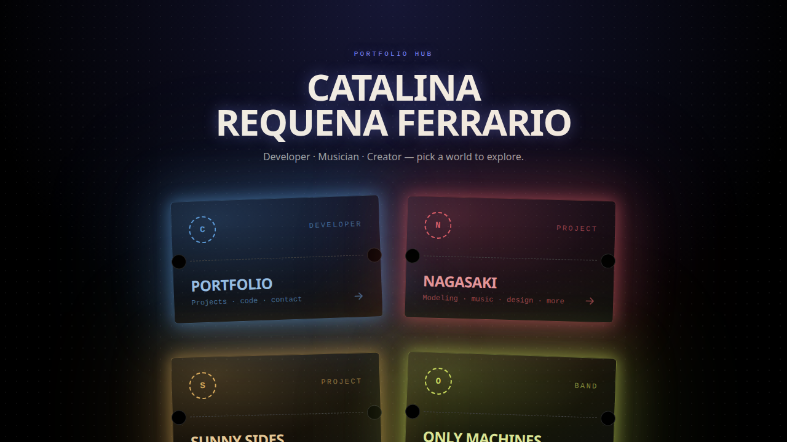

# crf — web personal

Web personal de Catalina Requena Ferrario: un hub que enlaza el portfolio de desarrollo con sus proyectos creativos (Nagasaki, Sunny Sides y la banda Only Machines).



## Qué incluye

- **Home tipo "hub"** con una tarjeta por proyecto, cada uno con su color de acento.
- **Nagasaki**: secciones de modeling, music, design, video, clothing y writing.
- **Panel de administración** (`/admin`) protegido con contraseña para editar el contenido de cada sección con un editor visual ([Puck](https://puckeditor.com)), sin tocar código.
- El contenido editado y las imágenes subidas se guardan en **Vercel Blob**.

## Stack

Next.js 16 (App Router, Server Actions, Route Handlers) · React 19 · TypeScript · Tailwind CSS v4 · Puck · Vercel Blob

## Arrancar en local

```bash
npm install
npm run dev     # http://localhost:3000
```

Para el panel de administración hace falta un `.env.local`:

| Variable | Descripción |
|---|---|
| `ADMIN_PASSWORD` | Contraseña de acceso a `/admin` |
| `ADMIN_COOKIE_SECRET` | Secreto con el que se firma la cookie de sesión |
| `BLOB_READ_WRITE_TOKEN` | Token de Vercel Blob para leer y guardar contenido |

## Scripts

```bash
npm run lint    # ESLint
npm run build   # build de producción
```

## Estado

En desarrollo: la sección de portfolio de desarrollo y Sunny Sides todavía tienen contenido provisional.
